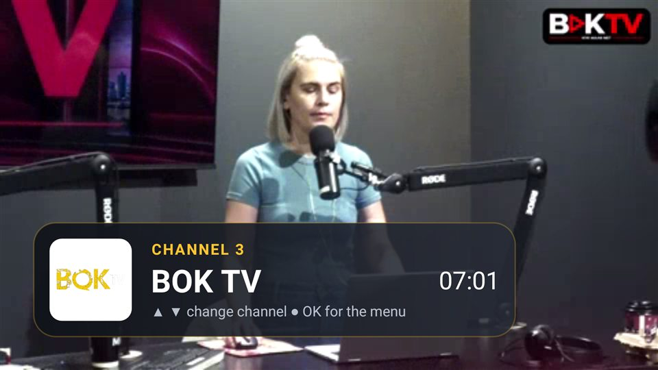
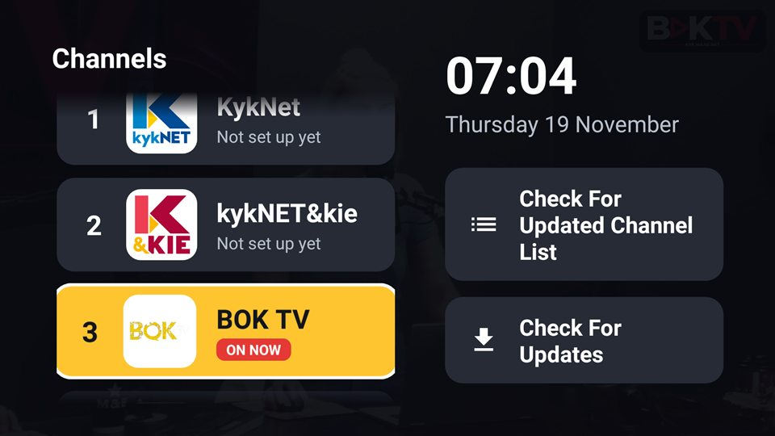
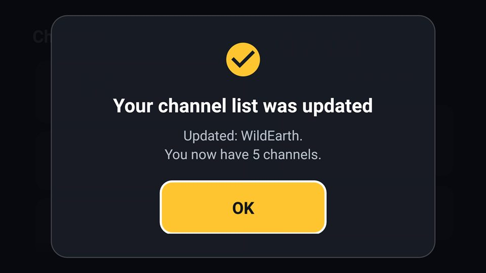
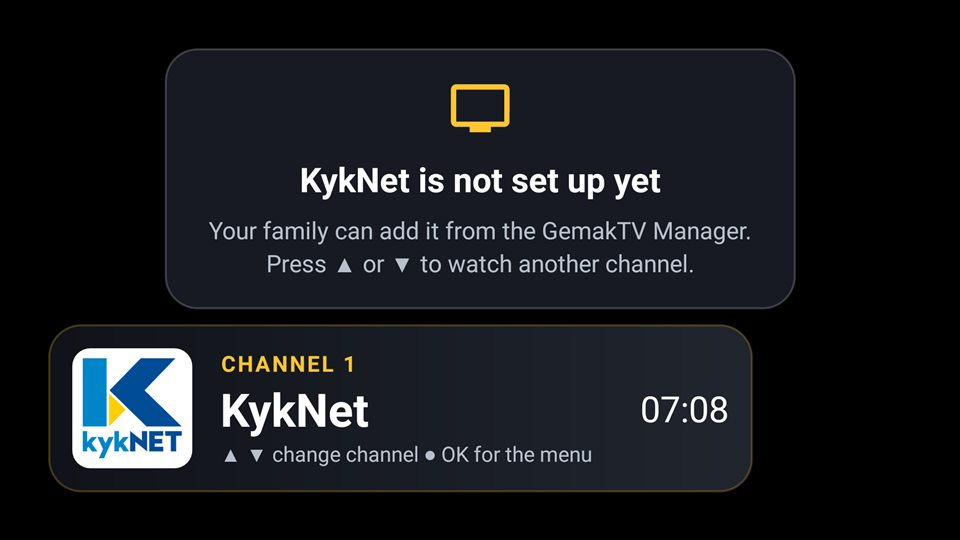
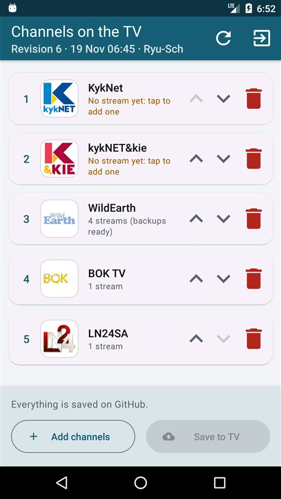
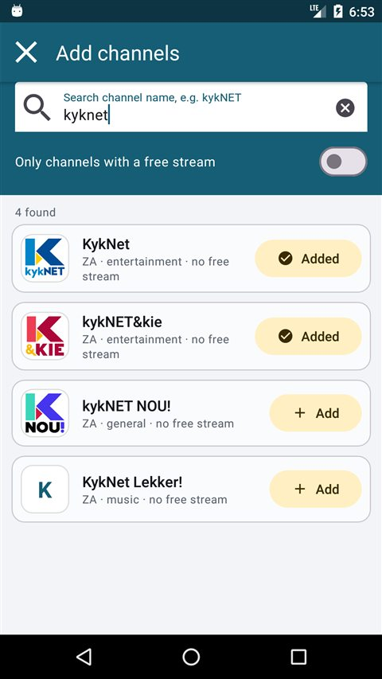
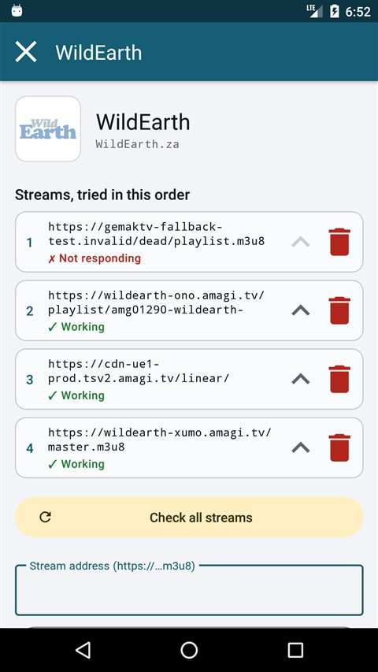
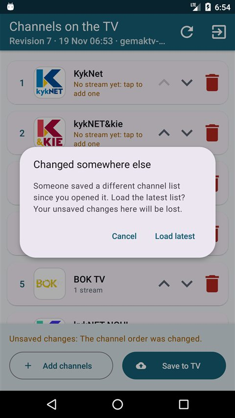

<p align="center"></p>

# GemakTV

*Gemak* (Afrikaans): ease, comfort.

GemakTV turns an Android TV box (built for a MyGica box on Android 6 with 1 GB RAM) into a television that does
one thing: show live channels. It is made for an elderly viewer. The box starts straight into the last channel,
nothing else can be opened, and the remote needs only ▲ ▼, OK, BACK, volume and power. Family choose the channels
from their phone, and both the channel list and app updates reach the TV through this GitHub repository,
encrypted.

| On the TV | |
|---|---|
|  |  |
| A banner names the channel for a few seconds after every change. | **OK** opens the menu: big channel cards, a clock, and the two update buttons. |
|  |  |
| *Check For Updated Channel List* says in plain words what changed. | A channel without a stream says so; ▲ ▼ skip it. |

| On the phone (GemakTV Manager) | | | |
|---|---|---|---|
|  |  |  |  |
| The TV's channels; reorder, remove, save | Search all ~40 000 iptv-org channels | Streams in failover order, with a health check | Concurrent edits are caught, never overwritten |

## What is in the box

- **GemakTV** (`src/GemakTV.Tv`): the TV app. It is the box's home screen and, when made device owner, a true
  single-app kiosk: other apps are hidden (so they cannot run in the background), the screen is pinned,
  updates install silently, and a crash-loop guard steps aside if a build ever misbehaves. Playback uses
  ExoPlayer (Media3) with small buffers, tries each channel's streams in turn, remembers which one worked, and
  keeps retrying calmly when a channel is down or the internet is out.
- **GemakTV Manager** (`src/GemakTV.Manager`): the family's phone app. Sign in with the GemakTV GitHub account,
  search the [iptv-org](https://github.com/iptv-org/iptv) catalogue, add channels or your own stream addresses,
  and save to the TV.
- **Publisher** (`tools/GemakTV.Publisher`): the owner's desktop tool. Creates the signing key, publishes the
  first channel list, and releases new TV builds (`scripts/release.ps1`).

Everything is C# on .NET 10, in layers: `Domain` ← `Application` ← `Infrastructure` ← apps. See
[docs/ARCHITECTURE.md](docs/ARCHITECTURE.md).

## kykNET: please read

kykNET and kykNET & kie are DStv (MultiChoice) subscription channels. They are in iptv-org's
[channel database](https://github.com/iptv-org/database/blob/master/data/channels.csv) (`KykNet.za`,
`kykNETkie.za`), but iptv-org has **no stream** for them, because it only lists streams that are free to watch
and no legitimate free stream exists. GemakTV does not go looking for unofficial copies.

Both channels are on the TV as channels 1 and 2 and show *"not set up yet"*. To make them play, paste a stream
address you are entitled to use (for example from an IPTV subscription that includes kykNET) into the channel's
page in GemakTV Manager and save. Until then the TV starts on the first channel that plays. The published list
includes three free South African channels that work today: **BOK TV** (Afrikaans), WildEarth and LN24SA.
Remove them in the manager if you prefer.

## The remote

| Key | Watching TV | In the menu |
|---|---|---|
| ▲ ▼ (or CH+ CH−) | Next / previous channel | Move between items |
| ◀ ▶ | Show what is on | Switch between channels and buttons |
| OK | Open the menu | Choose |
| BACK | Show what is on (never leaves the app) | Close |
| 1–9 | Go to that channel | |
| Volume, mute, power | As usual | As usual |

A printable card for the viewer: [docs/REMOTE-CARD.md](docs/REMOTE-CARD.md).

## Getting started

[docs/SETUP.md](docs/SETUP.md) walks through it: the signing key, the GitHub bot account, preparing the MyGica
box (including making GemakTV the device owner), managing channels, releasing updates, and the hidden
maintenance panel for a visiting helper.

```bash
dotnet test tests/GemakTV.Tests
```

```bash
powershell -File scripts/release.ps1 -VersionName 1.0.8
```

## How it was tested

- 103 unit tests: rules, use cases, the encryption's failure modes, the GitHub client against a faithful
  in-memory GitHub, catalogue parsing, the stream probe.
- End to end on emulators, against the real repository:
  - **Android 6 TV image (1 GB, home-screen mode):** channel list update, live playback of every working
    channel, failover from a dead stream to the next one, zapping that skips channels without streams, and
    self-update from 1.0.0 to 1.0.2 through Android's install screen.
  - **Plain Android 6 box (1 GB, device owner):** boot straight into GemakTV, screen pinning (HOME, Recents and
    other apps blocked), 22 apps hidden, silent self-updates 1.0.2 → 1.0.3 → 1.0.4, the maintenance panel's
    Wi-Fi round trip.
  - **Android 6 phone:** the manager against `tools/GemakTV.FakeGitHub` (sign-in, search, stream checks, edit,
    save, conflict detection), read back and decrypted with the publisher.
- Not tested here: a physical MyGica box and its remote, real audio output, and the real bot account's token
  (the account does not exist yet; see SETUP section 2).

## Security in one paragraph

The repository is public, but only the owner and the bot account can write, and repository rulesets confine the
bot to normal commits on the `published` branch. Published files are AES-256-GCM encrypted with a key derived
from the app signing key, which never enters the repository. The TV checks every update's checksum, package,
version and signing certificate before installing, and Android refuses updates signed by anyone else. The details,
including what the encryption does *not* protect against, are in
[docs/ARCHITECTURE.md](docs/ARCHITECTURE.md#security-model-honestly).

Channel data: [iptv-org](https://github.com/iptv-org) (CC0 / Unlicense). Icons: Material Design Icons (Apache 2.0).
